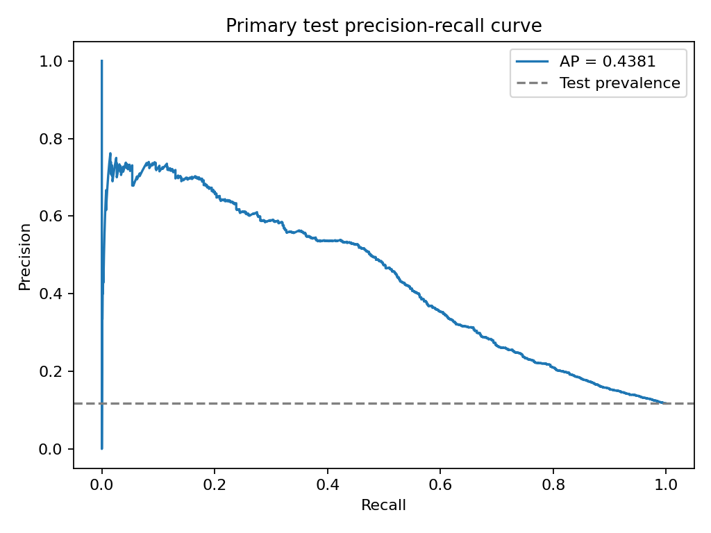

# Bank Marketing MLP

UCI Bank Marketing 데이터로 정기예금 가입 여부를 예측하는 PyTorch MLP를 구현했습니다. 2025년 3학년 1학기 딥러닝개론 개인 프로젝트에서 시작해, 훈련 데이터에만 전처리기를 학습하고 검증 데이터에서 학습 설정을 선택하도록 실험 절차를 구성했습니다.

[평가 지표](results/metrics.json) · [81개 설정의 탐색 결과](results/search_results.csv) · [공개 실험 기록](results/run_manifest.json) · [2025년 수업 코드](historical/baseline_2025.py)

## Test Results

통화 시간 `duration`을 제외한 MLP의 테스트 AP는 **0.4381**이었습니다. 같은 9,043행에서 로지스틱 회귀는 **0.4091**, 최빈 클래스 기준 모델은 **0.1170**이었습니다. 이 결과는 시드 `42`를 사용한 단일 층화 분할에서 얻었습니다. 연락 데이터를 사용할 수 있는 시점은 [입력 변수 설명](#dataset-and-preprocessing)에 정리했습니다.

| 모델 | 정확도 | 정밀도 | 재현율 | F1 | ROC-AUC | AP |
| --- | ---: | ---: | ---: | ---: | ---: | ---: |
| 최빈 클래스 (`DummyClassifier`) | 0.8830 | 0.0000 | 0.0000 | 0.0000 | 0.5000 | 0.1170 |
| 로지스틱 회귀 | 0.7549 | 0.2677 | 0.6304 | 0.3758 | 0.7720 | 0.4091 |
| **PyTorch MLP** | **0.7993** | **0.3198** | **0.6352** | **0.4255** | **0.7928** | **0.4381** |

가입(`yes`)을 양성으로 두고, 양성 예측 확률이 **0.5를 초과**하면 가입으로 분류했습니다. 표의 AP(Average Precision)는 전체 예측 점수에서 scikit-learn의 `average_precision_score`로 계산합니다. 결과 JSON의 `pr_auc`와 탐색 CSV의 `val_pr_auc` 열에 이 지표를 기록합니다. [평가 지표 파일](results/metrics.json)

최빈 클래스 모델은 모든 행을 미가입으로 예측해 정확도 88.30%, 가입 재현율 0%를 기록했습니다. MLP는 실제 가입 1,058건 중 672건을 찾았습니다. 가입으로 분류한 2,101건 중 실제 가입은 672건으로 정밀도는 31.98%였습니다.

회색 점선은 테스트셋의 실제 가입 비율 11.70%입니다. [혼동행렬](results/figures/confusion_matrix.png) · [ROC 곡선](results/figures/roc_curve.png) · [훈련·검증 손실 곡선](results/figures/training_curve.png) · [에포크별 학습 이력](results/selected_history.json)

## Dataset and Preprocessing

UCI 원본 아카이브 안의 `bank.zip`에서 `bank-full.csv`를 사용했습니다. 45,211행에 입력 변수 16개와 정기예금 가입 여부를 담은 `y` 열이 있습니다. `day` 열에는 마지막 연락일의 일자(1~31)가 들어 있습니다.

| 분할 | 행 수 | 가입 | 미가입 |
| --- | ---: | ---: | ---: |
| 훈련 | 28,934 | 3,385 | 25,549 |
| 검증 | 7,234 | 846 | 6,388 |
| 테스트 | 9,043 | 1,058 | 7,985 |
| 합계 | 45,211 | 5,289 | 39,922 |

가입 비율을 유지하는 층화 분할을 두 번 적용했습니다. 먼저 전체의 약 20%를 테스트용으로 떼고, 나머지의 약 20%를 검증용으로 분리했습니다. 각 행의 소속은 [분할 인덱스](results/split_indices.json)에 기록했습니다.

수치형은 `StandardScaler`, 범주형은 `OneHotEncoder(handle_unknown="ignore")`로 변환합니다. 두 전처리기는 훈련셋에서만 학습하고, 검증·테스트셋에는 그 변환을 그대로 적용했습니다. 원본의 문자열 `unknown`은 범주 값으로 유지하고, 실제 결측값이 있는 입력은 오류로 처리합니다.

주 실험 옵션 `realistic_pre_contact`는 마지막 통화가 끝나야 알 수 있는 `duration`을 뺍니다. 남은 원본 변수 15개를 전처리하면 공개 실험의 모델 입력은 50개입니다. 원본에는 마지막 연락의 일·월(`day`, `month`), 연락 수단(`contact`), 마지막 연락까지 포함한 캠페인 연락 횟수(`campaign`)도 있습니다. 실제 연락 대상을 선별하는 시점의 입력을 구성하려면 이 변수들의 확보 가능 여부를 별도로 확인해야 합니다. [UCI Bank Marketing 변수 설명](https://archive.ics.uci.edu/dataset/222/bank%2Bmarketing)

## Model and Selection

MLP는 공개 실험의 입력 50개를 받아 크기 128, 64인 은닉층 두 개를 거쳐 가입 여부를 나타내는 로짓 하나를 출력합니다. 각 은닉층에 Batch Normalization, LeakyReLU(`0.01`), Dropout을 적용하고, 선형층을 Kaiming 방식으로 초기화합니다.

| 학습 항목 | 설정 |
| --- | --- |
| 손실 함수 | `BCEWithLogitsLoss(pos_weight)` |
| 양성 가중치 | 훈련셋 미가입 25,549건 ÷ 가입 3,385건 ≈ `7.5477` |
| 옵티마이저 | Adam, 가중치 감쇠 `1e-5` |
| 학습률 조정 | `CosineAnnealingLR(T_max=50)` |
| 그래디언트 클리핑 | 최대 노름 `0.5` |
| 학습 종료 | 최대 200 에포크, 검증 손실이 10 에포크 동안 개선되지 않으면 조기 종료 |

| 탐색 항목 | 후보 | 선택값 |
| --- | --- | --- |
| 학습률 | `0.1`, `0.001`, `0.0005` | `0.001` |
| 배치 크기 | `32`, `64`, `128` | `32` |
| 첫 번째 Dropout 비율 | `0.3`, `0.4`, `0.5` | `0.5` |
| 두 번째 Dropout 비율 | `0.3`, `0.4`, `0.5` | `0.4` |

81개 조합을 각각 학습하고, 각 조합에서 **가중 검증 손실이 가장 낮았던 에포크**의 가중치를 복원합니다. 복원한 모델들의 **검증 AP**로 설정을 선택하며, AP가 같으면 검증 손실이 낮은 조합, 그다음에는 탐색 순서가 앞선 조합을 선택합니다. 공개 결과에서는 81개 조합이 모두 조기 종료됐고, 35번 조합의 38번째 에포크가 검증 AP **0.4549**로 선택됐습니다. [탐색 결과 CSV](results/search_results.csv)

설정을 확정한 뒤 테스트셋에서 MLP를 평가합니다. 두 비교 모델은 같은 전처리 결과와 분할을 사용합니다. 최빈 클래스 모델은 훈련셋의 다수 클래스를 예측하고, 로지스틱 회귀는 `class_weight="balanced"`로 학습했습니다. [비교 모델 코드](src/bank_marketing/baselines.py)

## Duration Sensitivity

분할, 시드, 선택된 하이퍼파라미터를 고정하고 `duration`만 입력에 추가해 MLP를 다시 학습했습니다. 결과는 `duration_inclusive_sensitivity`에 기록했습니다.

| 테스트 지표 | `duration` 제외 | `duration` 포함 |
| --- | ---: | ---: |
| 정확도 | 0.7993 | 0.8493 |
| 재현율 | 0.6352 | 0.8677 |
| F1 | 0.4255 | 0.5739 |
| ROC-AUC | 0.7928 | 0.9277 |
| AP | 0.4381 | 0.6021 |

이 분할에서 통화 시간을 사용하면 AP가 약 **0.1640** 높아졌습니다. `duration` 포함 결과는 통화가 끝난 뒤 알 수 있는 변수를 사용했을 때 점수가 얼마나 달라지는지 보여줍니다. 결과의 해석 범위는 이 데이터셋과 분할, 시드에 한정됩니다. 이후 캠페인에 적용하려면 시간 순서에 따른 별도 평가가 필요하며, 연락이 가입에 미치는 효과를 알려면 별도의 인과 분석이 필요합니다.

## Reproduction

저장소를 복제한 뒤 Python 가상환경을 만듭니다. 공개 실험은 Python 3.11.3에서 실행했고, GitHub Actions는 Python 3.12를 사용합니다.

~~~bash
git clone https://github.com/tangerineYR/bank-marketing-mlp.git
cd bank-marketing-mlp
python -m venv .venv
~~~

Linux·macOS에서는 `source .venv/bin/activate`, Windows PowerShell에서는 `.\.venv\Scripts\Activate.ps1`로 활성화합니다. 아래 명령은 활성화한 환경에서 실행합니다.

~~~bash
python -m pip install -r requirements.txt
~~~

### Offline Checks

아래 명령은 UCI 데이터를 내려받기 전에 실행할 수 있습니다. 단위 테스트 25개로 전처리와 학습·평가 동작을 확인하고, 합성 데이터로 짧은 학습을 실행합니다. 마지막 명령은 저장된 탐색 결과에서 선택 기준을 다시 적용해 평가 기록과 대조하고, 분할·학습 이력·그림 파일을 검사합니다. 세 검사는 [GitHub Actions](https://github.com/tangerineYR/bank-marketing-mlp/actions/workflows/ci.yml)에서도 실행됩니다.

~~~bash
python -m unittest discover -s tests -v
python -m scripts.smoke
python -m scripts.validate_artifacts results
~~~

### Full Experiment

다음 명령은 CPU에서 81개 조합, 두 비교 모델, 통화 시간 포함 실험까지 실행합니다. 기본적으로 UCI 공식 아카이브를 내려받습니다. 원본 `bank-full.csv`를 확보했다면 첫 명령에 `--csv-path data/bank-full.csv`를 추가합니다. 가용 CPU나 메모리가 적으면 `--workers 1`로 실행할 수 있습니다.

~~~bash
python -m scripts.run_experiment --seed 42 --feature-mode realistic_pre_contact --device cpu --workers 8 --threads 1 --sensitivity --output-dir results-rerun
python -m scripts.validate_artifacts results-rerun
~~~

실행할 때마다 새 출력 폴더를 지정합니다. 이 명령은 `results-rerun/`에 지표, 탐색 결과, 분할 인덱스, 학습 이력, 그래프 4장과 선택된 MLP 가중치 `selected_checkpoint.pt`를 생성합니다. [`run_manifest.json`](results/run_manifest.json)은 공개된 실험의 환경과 실행 조건을 기록한 별도 파일입니다. 같은 절차를 재실행하더라도 설치된 라이브러리 버전과 실행 환경에 따라 수치가 달라질 수 있습니다.

## Coursework and Attribution

[2025년 수업 코드](historical/baseline_2025.py)에서 MLP 구조와 81개 조합 탐색이 시작됐습니다. 당시에는 데이터를 분할하기 전에 표준화했습니다. 현재 구현에서는 분할과 훈련셋 전처리, 검증 AP에 따른 선택, 테스트셋 평가 순서로 실행합니다. 표와 그림은 현재 평가 절차로 얻은 공개 결과입니다. [학습·평가 코드](src/bank_marketing/experiment.py)

Moro, S., Rita, P., & Cortez, P. (2014). *Bank Marketing* [데이터셋]. UCI Machine Learning Repository. 데이터셋 라이선스는 CC BY 4.0입니다. [DOI](https://doi.org/10.24432/C5K306) · [UCI 데이터셋](https://archive.ics.uci.edu/dataset/222/bank%2Bmarketing)

<<<<<<< HEAD
같은 `bank-full.csv`를 관계형 모델링과 SQL 기술통계에 사용한 별도 프로젝트도 있습니다. [Bank Marketing SQL Analysis](https://github.com/tangerineYR/bank-marketing-sql-analysis)
=======
---

## 🔧 Engineering Decisions & Validation

| 검토 항목 | 설계 결정 | 검증 방법 |
|---|---|---|
| 입력 변수의 사용 가능 시점 | 사전 연락 대상 선별을 위한 Primary 모델에서 통화 종료 후에만 알 수 있는 `duration` 제외 | Feature Mode 검증 테스트 |
| 데이터 누수 방지 | 전처리기의 학습(Fit)은 훈련 데이터에만 수행하고 검증·테스트 데이터에는 동일한 변환 적용 | Train-only 전처리 테스트 |
| 클래스 불균형 대응 | 훈련 데이터의 클래스 분포를 기준으로 BCE 손실함수의 양성 클래스 가중치 계산 | 클래스 가중치 검증 테스트 |
| 하이퍼파라미터 선택 | 81개 조합을 탐색하고 Validation PR-AUC(AP)를 기준으로 최적 설정 선택 | 탐색 및 모델 선택 테스트 |
| Early Stopping | 검증 손실이 가장 낮았던 Epoch의 모델 가중치를 복원 | 체크포인트 복원 테스트 |
| 테스트셋 독립성 | 검증 데이터 기반 모델 선택을 완료한 뒤 분리된 테스트셋에서 최종 성능 평가 | 학습·평가 파이프라인 테스트 |
| 비교 모델 평가 | DummyClassifier·Logistic Regression·MLP를 동일한 테스트셋에서 평가 | 최종 테스트 성능 지표 |
| 실험 재현성 | Random Seed, 데이터 분할, 실행 환경, 학습·평가 결과를 기록 | 실험 산출물 및 자동화 테스트 |

### Coursework Implementation

MLP 모델 구조와 81개 하이퍼파라미터 조합 탐색은 2025년 딥러닝개론 수업 프로젝트에서 출발했습니다. 당시 구현 코드는 [`historical/baseline_2025.py`](historical/baseline_2025.py)에 별도로 보존했습니다.

현재 공개된 학습·평가 파이프라인에는 데이터 누수를 고려한 전처리, 검증 데이터 기반 모델 선택, 최적 체크포인트 복원 및 비교 모델 평가를 적용했습니다.

README에 제시된 성능 수치는 보존된 수업 당시 코드가 아니라, 현재 공개된 학습·평가 파이프라인에서 산출한 결과입니다.

---

## ⚠️ Scope & Limitations

**Single Split and Seed.** 현재 수치는 단일 stratified random split과 primary seed 42로 얻은 결과입니다. 여러 seed의 평균 성능이나 신뢰구간을 보고하지 않습니다.

**Temporal Generalization.** Random split은 실제 향후 캠페인으로의 시간적 일반화 성능을 완전히 재현하지 않습니다.

**Feature Availability.** Primary setting에서는 `duration`을 제외했지만, `campaign`, 연락 시점 등의 추가 feature도 구체적인 운영 시점에서 사용 가능한지 확인해야 합니다.

**Class Imbalance.** Majority-class Accuracy만으로 실제 가입 고객 탐지 성능을 판단하지 않습니다. PR-AUC, Precision, Recall, F1 등 여러 지표를 함께 해석합니다.

**Not a Deployed Service.** 이 프로젝트는 학습·평가 실험이며, 실제 은행 고객 데이터나 운영 시스템에 배포된 서비스가 아닙니다.

**No Causal Interpretation.** 관측 데이터의 분류 성능이 특정 마케팅 행동의 인과적 효과를 입증하는 것은 아닙니다.

---

## 📚 Dataset & Attribution

**Dataset:** [Bank Marketing — UCI Machine Learning Repository](https://archive.ics.uci.edu/dataset/222/bank+marketing)

Moro, S., Rita, P., & Cortez, P. (2014). *Bank Marketing* [Dataset]. UCI Machine Learning Repository. [DOI: 10.24432/C5K306](https://doi.org/10.24432/C5K306).

데이터셋 라이선스: **CC BY 4.0**.

이 저장소에는 원본 데이터셋 CSV를 포함하지 않습니다. 전체 실험을 실행할 때 UCI에서 제공하는 원본 데이터 아카이브를 다운로드합니다.

---

## 🔗 Related Project

**[Bank Marketing SQL Analysis](https://github.com/tangerineYR/bank-marketing-sql-analysis)**

동일한 Bank Marketing 도메인을 데이터베이스 관점에서 다룬 별도의 개인 프로젝트입니다.

- **연계 프로젝트 — SQL 분석:** 관계형 모델링, 데이터 무결성, SQL 기술통계, 규칙 기반 의사결정 지원
- **이 프로젝트 — MLP 분류:** PyTorch MLP, 불균형 이진 분류, 학습 최적화, 검증 기반 모델 평가

동일한 데이터 도메인을 서로 다른 기술적 관점에서 분석한 두 프로젝트입니다.

---

**높은 정확도 수치보다 중요한 것은 데이터 누수를 방지하고 검증 절차를 준수한 신뢰할 수 있는 모델 평가입니다.**

>>>>>>> 42886b9a1b88b9d89602f11c2c687de7c2be5a42
