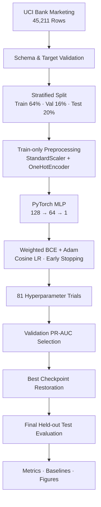
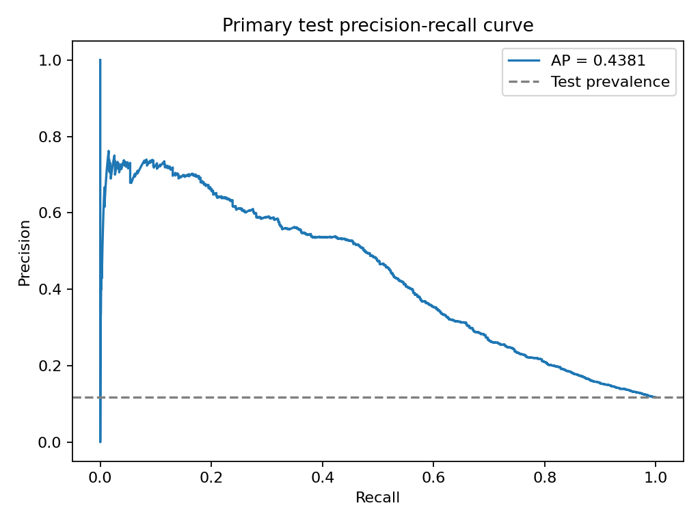
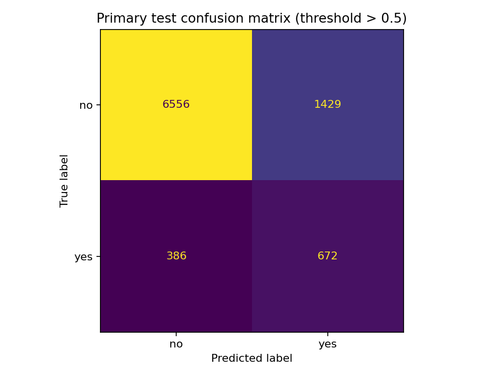

<div align="center">

# Bank Marketing MLP

### Leakage-aware Tabular Classification with PyTorch

**UCI Bank Marketing 데이터를 활용해 정기예금 가입 여부를 분류하는 PyTorch MLP를 구현하고, 데이터 누수 방지·클래스 불균형 대응·검증 기반 모델 선택을 통해 재현 가능한 학습 및 평가 파이프라인을 구축한 프로젝트입니다.**

<br/>


**[Results](results/metrics.json)** · **[Hyperparameter Search](results/search_results.csv)** · **[Experiment Manifest](results/run_manifest.json)** · **[Historical Baseline](historical/baseline_2025.py)**

</div>

---

## 📌 Overview

딥러닝개론 수업에서 **PyTorch 기반 MLP(128→64→1)**를 직접 구현하고, Batch Normalization, Dropout, Kaiming Initialization, Class-weighted BCE Loss, Learning Rate Scheduling, Early Stopping과 81개 하이퍼파라미터 조합 탐색을 적용했습니다.

현재 학습 파이프라인은 **입력 특성의 사용 가능 시점, 훈련 데이터 기반 전처리, 검증 데이터 기반 하이퍼파라미터 선택, 최적 체크포인트 복원 및 독립 테스트셋 평가**를 고려해 설계했습니다. 이를 통해 모델 성능뿐 아니라 평가 과정의 신뢰성과 재현성을 검증합니다.

프로젝트의 핵심은 복잡한 모델을 추가하는 것이 아니라, 기존 딥러닝 모델을 **신뢰할 수 있는 평가 프로토콜로 검증할 수 있도록 개선한 것**입니다.

### Project Info

| 항목 | 내용 |
| --- | --- |
| **프로젝트 유형** | 전공 프로젝트 · 개인 |
| **수행 시기** | 3학년 1학기 · 2025 |
| **과목** | 딥러닝개론 |
| **Dataset** | UCI Bank Marketing (`bank-full.csv`) |
| **Dataset Size** | 45,211 rows · 16 input features · 1 target |
| **Task** | Binary Classification |
| **Positive Class** | Term deposit subscription = `yes` |
| **Model** | PyTorch MLP (128→64→1) |
| **Class Imbalance** | `BCEWithLogitsLoss(pos_weight)` |
| **Hyperparameter Search** | 81 configurations |
| **Model Selection** | Validation PR-AUC (Average Precision) |
| **Test Evaluation** | Held-out stratified test split |
| **Validation** | 25 local automated tests · synthetic smoke |

---

## 🏗️ Architecture



**Test data is not used to select hyperparameters.** The primary model is selected on validation data, and its held-out test evaluation is performed after model selection.

---

## 🧹 Leakage-aware Data Preprocessing

### 1. Feature Availability: Excluding `duration`

UCI Bank Marketing의 `duration`은 마지막 통화 시간(초)을 의미하며, 통화가 종료된 이후에야 확인할 수 있습니다.

따라서 실제 **사전 연락 대상 선별(pre-contact targeting)** 을 염두에 둔 모델에서 해당 변수를 사용하는 것은 부적절합니다.

이를 해결하기 위해 두 가지 실험 조건을 구분했습니다.

| Setting | `duration` | Purpose |
| --- | --- | --- |
| **Primary — `realistic_pre_contact`** | 제외 | Pre-contact classification evaluation |
| Secondary — `duration_inclusive` | 포함 | Feature-availability sensitivity analysis |

Primary 모델은 `duration`을 제외한 15개 원본 입력 변수에서 시작하며, 전처리 후 **50-dimensional input**을 사용합니다.

Secondary 실험은 동일 split과 primary에서 선택된 하이퍼파라미터를 사용해 `duration` 포함 여부의 영향을 확인합니다. 이 결과는 실제 사전 연락 모델의 성능으로 해석하지 않습니다.

### 2. Train-only Preprocessing

전체 데이터에 전처리를 학습하면 검증·테스트 데이터의 분포가 학습 과정에 반영될 수 있습니다.

이를 방지하기 위해 데이터 분할을 먼저 수행하고, StandardScaler와 OneHotEncoder를 훈련 데이터에만 fit합니다. 검증·테스트 데이터에는 학습된 변환만 적용합니다.

```text
Raw Data
   ↓
Stratified Train / Validation / Test Split
   ↓
Fit Preprocessor on Train Only
   ├── Numeric → StandardScaler
   └── Categorical → OneHotEncoder
                        (handle_unknown="ignore")
   ↓
Transform Train / Validation / Test
```

검증·테스트 데이터의 분포를 사용해 스케일링 기준이나 categorical schema를 학습하지 않습니다.

UCI 원본의 문자열 `"unknown"`은 실제 NaN으로 간주하지 않고 범주형 값으로 유지합니다.

### 3. Dataset Split

| Split | Rows | Positive | Negative |
| --- | ---: | ---: | ---: |
| Train | 28,934 | 3,385 | 25,549 |
| Validation | 7,234 | 846 | 6,388 |
| Test | 9,043 | 1,058 | 7,985 |
| **Total** | **45,211** | **5,289** | **39,922** |

양성 클래스 비율은 전체 데이터의 약 **11.7%** 로, 클래스 불균형을 고려한 학습과 평가가 필요합니다.

---

## 🧠 PyTorch MLP

MLP는 두 개의 은닉층(128, 64)과 하나의 출력층으로 구성되며, Batch Normalization, LeakyReLU, Dropout을 적용합니다.

```text
Input (50)
    ↓
Linear(50, 128)
BatchNorm1d(128)
LeakyReLU(0.01)
Dropout(dropout1)
    ↓
Linear(128, 64)
BatchNorm1d(64)
LeakyReLU(0.01)
Dropout(dropout2)
    ↓
Linear(64, 1)
    ↓
Binary Logit
```

학습에는 다음 설정을 사용합니다.

| Component | Implementation |
| --- | --- |
| Loss | `BCEWithLogitsLoss(pos_weight)` |
| Class Weight | Negative / Positive count from train labels |
| Optimizer | Adam |
| Weight Decay | `1e-5` |
| Initialization | Kaiming Normal for LeakyReLU |
| Scheduler | CosineAnnealingLR (`T_max=50`) |
| Gradient Clipping | Max norm `0.5` |
| Max Epochs | 200 |
| Early Stopping | Patience 10, validation loss |
| Checkpoint | Best validation-loss weights restored |
| Random Seed | 42 |

### Addressing Class Imbalance

정기예금 미가입 클래스가 전체의 약 88.3%를 차지하므로, 단순 Accuracy만으로는 양성 클래스 탐지 성능을 평가하기 어렵습니다.

훈련 데이터의 클래스 비율을 기반으로 다음 가중치를 적용합니다.

\[
\text{pos\_weight}=\frac{N_{\text{negative, train}}}{N_{\text{positive, train}}}
\]

이번 실행의 `pos_weight`는 약 **7.5477**입니다.

---

## 🔍 Hyperparameter Search

Learning Rate, Batch Size, 두 은닉층의 Dropout Rate를 조합한 81개 설정을 탐색하고, Validation Average Precision(AP)을 기준으로 모델을 선택합니다.

| Parameter | Search Space |
| --- | --- |
| Learning Rate | `0.1`, `0.001`, `0.0005` |
| Batch Size | `32`, `64`, `128` |
| Dropout 1 | `0.3`, `0.4`, `0.5` |
| Dropout 2 | `0.3`, `0.4`, `0.5` |

총 **3 × 3 × 3 × 3 = 81 configurations**을 학습했습니다.

각 trial의 best validation-loss checkpoint를 복원한 뒤 **Validation PR-AUC(AP)** 를 기준으로 하이퍼파라미터를 선택했습니다.

### Selected Configuration

| 항목 | 값 |
| --- | ---: |
| Learning Rate | `0.001` |
| Batch Size | `32` |
| Dropout 1 | `0.5` |
| Dropout 2 | `0.4` |
| Best Epoch | `38` |
| **Validation PR-AUC** | **0.4549** |

총 81개 trial이 모두 성공했으며, 모든 trial이 Early Stopping으로 종료됐습니다.

세부 결과는 [`search_results.csv`](results/search_results.csv)에 기록했습니다. 이 파일에는 test metric을 포함하지 않습니다.

---

## 📊 Final Evaluation

Primary MLP는 validation 기반 모델 선택을 마친 뒤 held-out test set에서 평가했습니다.

Positive class는 `yes`이며, 분류 threshold는 `probability > 0.5`입니다.

### Test Performance

| Model | Accuracy | Precision | Recall | F1 | ROC-AUC | PR-AUC |
| --- | ---: | ---: | ---: | ---: | ---: | ---: |
| DummyClassifier | **0.8830** | 0.0000 | 0.0000 | 0.0000 | 0.5000 | 0.1170 |
| LogisticRegression | 0.7549 | 0.2677 | 0.6304 | 0.3758 | 0.7720 | 0.4091 |
| **PyTorch MLP** | **0.7993** | **0.3198** | **0.6352** | **0.4255** | **0.7928** | **0.4381** |

PR-AUC는 scikit-learn의 `average_precision_score`를 사용했습니다.

### Interpretation

- DummyClassifier는 모든 관측치를 음성으로 예측하므로 Accuracy는 높지만, 실제 가입 고객을 탐지하지 못해 positive-class Recall과 F1은 0입니다.
- PyTorch MLP는 동일한 held-out test split에서 Logistic Regression보다 높은 PR-AUC와 F1을 기록했습니다.
- 이러한 결과는 **이번 단일 데이터셋·분할·seed 조건에서의 비교**이며, 일반적으로 MLP가 모든 tabular 데이터에서 우수하다는 의미는 아닙니다.

### Precision–Recall Curve



### Confusion Matrix



Primary MLP의 혼동행렬은 다음과 같습니다.

| Actual / Predicted | No | Yes |
| --- | ---: | ---: |
| **No** | 6,556 | 1,429 |
| **Yes** | 386 | 672 |

테스트셋의 실제 가입자 1,058건 중 **672건을 양성으로 탐지**했으며, 해당 운영점에서 Precision은 약 32.0%입니다.

추가 평가 그림은 [ROC Curve](results/figures/roc_curve.png)와 [Training Curve](results/figures/training_curve.png)에서 확인할 수 있습니다.

---

## 🔬 Duration Sensitivity Analysis

원본 데이터의 `duration` 포함 여부가 성능에 미치는 영향을 별도로 비교했습니다.

| Metric | Duration Excluded (Primary) | Duration Included (Secondary) |
| --- | ---: | ---: |
| Accuracy | 0.7993 | 0.8493 |
| Recall | 0.6352 | 0.8677 |
| F1 | 0.4255 | 0.5739 |
| ROC-AUC | 0.7928 | 0.9277 |
| **PR-AUC** | **0.4381** | **0.6021** |

`duration`을 포함하면 PR-AUC가 0.4381에서 0.6021로 상승했습니다.

하지만 통화 종료 후에만 확인할 수 있는 변수이므로 이 결과를 사전 마케팅 대상 선정 모델의 대표 성능으로 사용하지 않습니다.

**이 실험의 목적은 더 높은 점수를 제시하는 것이 아니라, feature가 실제 의사결정 시점에 사용 가능한지 검토하는 것의 중요성을 확인하는 것입니다.**

---

## 🛠️ Tech Stack

| Category | Technology |
| --- | --- |
| Deep Learning | PyTorch |
| Data Processing | Pandas, NumPy |
| Preprocessing | scikit-learn |
| Model | Multilayer Perceptron |
| Optimization | Adam, CosineAnnealingLR |
| Evaluation | scikit-learn metrics |
| Visualization | Matplotlib |
| Testing | Python unittest |
| CI | GitHub Actions (workflow configured) |
| Dataset | UCI Machine Learning Repository |

---

## 📁 Project Structure

```text
bank-marketing-mlp/
│
├── historical/
│   ├── baseline_2025.py           # 원본 과제 코드
│   └── provenance.json            # 원본 SHA-256·보존 정보
│
├── src/
│   └── bank_marketing/
│       ├── __init__.py
│       ├── data.py                # 데이터 검증·분할·train-only 전처리
│       ├── model.py               # PyTorch MLP
│       ├── train.py               # 학습·Early Stopping·81-trial 탐색
│       ├── evaluate.py            # 평가 지표·시각화
│       ├── baselines.py           # Dummy / Logistic Regression
│       └── experiment.py          # 전체 실험 orchestration
│
├── scripts/
│   ├── run_experiment.py          # 전체 실험 CLI
│   ├── smoke.py                   # Offline synthetic smoke test
│   └── validate_artifacts.py      # 결과 artifact 검증
│
├── results/
│   ├── metrics.json               # 모델 평가 지표 및 데이터 정보
│   ├── search_results.csv         # 81개 하이퍼파라미터 탐색 결과
│   ├── split_indices.json         # 학습·검증·테스트 분할 인덱스
│   ├── selected_history.json      # 선택 모델의 학습 곡선 데이터
│   ├── run_manifest.json          # 기록된 실험의 실행 환경·소스 체크섬
│   └── figures/
│       ├── training_curve.png
│       ├── confusion_matrix.png
│       ├── precision_recall_curve.png
│       └── roc_curve.png
│
├── tests/
│   ├── test_data.py
│   ├── test_model.py
│   ├── test_training.py
│   ├── test_evaluation.py
│   └── test_pipeline.py
│
├── .github/
│   └── workflows/
│       └── ci.yml
│
├── .gitignore
├── requirements.txt
└── README.md
```

최종 모델 checkpoint는 저장소에 포함하지 않으며, `results/`의 machine-readable artifact와 그래프를 평가 근거로 보존합니다.

---

## ▶️ Quick Start

### 1. Clone & Install

```bash
git clone https://github.com/tangerineYR/bank-marketing-mlp.git
cd bank-marketing-mlp

python -m pip install -r requirements.txt
```

### 2. Run Tests

외부 UCI 데이터 다운로드 없이 실행할 수 있습니다.

```bash
python -m unittest discover -s tests -v
python -m scripts.smoke
```

자동화 테스트 25개와 synthetic smoke test를 통해 데이터 전처리, 모델 구조, 학습·평가 및 실험 파이프라인을 검증합니다. GitHub Actions는 push 및 pull request에서 이를 자동 실행합니다.

### 3. Validate Existing Results

```bash
python -m scripts.validate_artifacts results
```

저장된 탐색 결과, 모델 선택 기준, 평가 지표, 데이터 분할, 그림 파일 형식 및 수업 구현 코드의 SHA-256을 검증합니다. 전체 모델을 다시 학습하거나 run_manifest.json에 기록된 모든 소스 파일의 체크섬을 현재 코드와 비교하지는 않습니다.

run_manifest.json의 source_sha256은 저장된 실험을 수행한 당시의 코드 스냅샷을 기록한 값입니다. 이후의 문서·주석 변경으로 현재 저장소의 파일 해시와 달라질 수 있습니다.

### 4. Reproduce Full Experiment

```bash
python -m scripts.run_experiment --seed 42 --feature-mode realistic_pre_contact --device cpu --sensitivity --workers 8 --output-dir results-rerun
```

전체 실행은 81개 MLP trial과 baseline 평가를 수행합니다.

UCI 공식 archive를 다운로드하므로 데이터 접근을 위한 네트워크 연결이 필요합니다.

기존 검증 결과를 덮어쓰지 않도록 새로운 output directory를 지정합니다.

results-rerun/에는 모델 지표, 탐색 결과, 분할 인덱스, 학습 이력 및 시각화가 생성됩니다. run_manifest.json은 저장된 실험에 대한 별도 실행 기록으로, 현재 실험 CLI가 자동 생성하는 파일은 아닙니다.

```bash
python -m scripts.validate_artifacts results-rerun
```

원본 CSV를 별도로 확보했다면 `--csv-path` 옵션으로 지정할 수도 있습니다.

### 5. CI

`.github/workflows/ci.yml`은 Python 3.12 환경에서 테스트와 synthetic smoke를 실행하도록 구성했습니다.

전체 81-trial 학습은 CI에서 반복 실행하지 않습니다.

---

## 🔧 Engineering Decisions & Validation

| Concern | Engineering Decision | Verification |
|---|---|---|
| Feature Availability | Exclude `duration` from the primary pre-contact setting | Feature-mode tests |
| Data Leakage | Fit preprocessing only on training data | Train-only preprocessing tests |
| Class Imbalance | Compute BCE positive-class weight from training labels | Class-weight tests |
| Hyperparameter Selection | Select among 81 configurations using validation AP | Search and selection tests |
| Early Stopping | Restore the checkpoint with minimum validation loss | Checkpoint restoration tests |
| Test Isolation | Evaluate the primary MLP after model selection | Pipeline isolation tests |
| Model Comparison | Evaluate DummyClassifier, Logistic Regression, and MLP | Held-out test metrics |
| Reproducibility | Record random seed, data split, runtime environment, and results | Experiment artifacts and automated tests |

### Coursework Implementation

The MLP architecture and 81-configuration search originate from the deep learning course project. The coursework implementation is preserved in [`historical/baseline_2025.py`](historical/baseline_2025.py).

The current evaluation pipeline introduces leakage-aware preprocessing, validation-based model selection, checkpoint restoration, and baseline comparisons.

The performance figures reported in this README are produced by the evaluated pipeline, not by the preserved coursework script.

---

## ⚠️ Scope & Limitations

**Single Split and Seed.** 현재 수치는 단일 stratified random split과 primary seed 42로 얻은 결과입니다. 여러 seed의 평균 성능이나 신뢰구간을 보고하지 않습니다.

**Temporal Generalization.** Random split은 실제 향후 캠페인으로의 시간적 일반화 성능을 완전히 재현하지 않습니다.

**Feature Availability.** Primary setting에서는 `duration`을 제외했지만, `campaign`, 연락 시점 등의 추가 feature도 구체적인 운영 시점에서 사용 가능한지 확인해야 합니다.

**Class Imbalance.** Majority-class Accuracy만으로 실제 가입 고객 탐지 성능을 판단하지 않습니다. PR-AUC, Precision, Recall, F1 등 여러 지표를 함께 해석합니다.

**Not a Deployed Service.** 이 프로젝트는 학습·평가 실험이며, 실제 은행 고객 데이터나 운영 시스템에 배포된 서비스가 아닙니다.

**No Causal Interpretation.** 관측 데이터의 분류 성능이 특정 마케팅 행동의 인과적 효과를 입증하는 것은 아닙니다.

---

## 📚 Dataset & Attribution

**Dataset:** [Bank Marketing — UCI Machine Learning Repository](https://archive.ics.uci.edu/dataset/222/bank+marketing)

Moro, S., Rita, P., & Cortez, P. (2014). *Bank Marketing* [Dataset]. UCI Machine Learning Repository. [DOI: 10.24432/C5K306](https://doi.org/10.24432/C5K306).

Dataset license: **CC BY 4.0**.

This repository does not include the original dataset as a committed CSV file; the full experiment fetches the original UCI archive.

---

## 🔗 Related Project

**[Bank Marketing SQL Analysis](https://github.com/tangerineYR/bank-marketing-sql-analysis)**

동일한 Bank Marketing 도메인을 데이터베이스 관점에서 다룬 별도의 개인 프로젝트입니다.

- **SQL Project:** 관계형 모델링, 데이터 무결성, SQL 기술통계, rule-based 의사결정 지원
- **This Project:** PyTorch MLP, 불균형 이진 분류, 학습 최적화, 검증 기반 모델 평가

동일한 데이터 도메인을 서로 다른 기술적 관점에서 분석한 두 프로젝트입니다.

---

<div align="center">

**Reliable evaluation matters more than an impressive accuracy number.**

</div>